# Installer la bêta de MyElectricalData sur Proxmox

Le script Proxmox installe au choix la version **stable** ou la **bêta** de MyElectricalData. La bêta apporte les nouveautés avant leur arrivée dans la version officielle, comme les **heures creuses saisonnières** (plages différentes l'hiver et l'été). C'est la même bêta que l'add-on Home Assistant « MyElectricalData New Beta ».

**Sommaire**

- [Avant de commencer](#avant-de-commencer)
- [Nouveau conteneur en bêta](#nouveau-conteneur-en-bêta)
- [Conteneur déjà installé : passer en bêta sans réinstaller](#conteneur-déjà-installé--passer-en-bêta-sans-réinstaller)
- [Vérifier que la bêta est installée](#vérifier-que-la-bêta-est-installée)
- [Heures creuses saisonnières](#heures-creuses-saisonnières)
- [Mises à jour et retour à la version stable](#mises-à-jour-et-retour-à-la-version-stable)

## Avant de commencer

| Il faut | Où le trouver |
| --- | --- |
| Un serveur Proxmox VE | Interface web, avec le **shell du nœud** (clic sur le nom du nœud, puis **>_ Shell**) |
| Client ID et Client Secret | Sur la passerelle MyElectricalData, dans **Paramètres › API** |
| Environ 10 minutes | La compilation de l'interface est l'étape la plus longue |

> [!WARNING]
> La bêta sert à tester. Faites une sauvegarde Proxmox du conteneur avant de passer un conteneur existant en bêta : **Backup › Backup now**.

## Nouveau conteneur en bêta

La bêta s'installe directement : pas besoin d'installer d'abord la version stable.

### 1. Lancer le script

À taper dans le **shell du nœud Proxmox**, pas dans la console d'un conteneur :

```bash
bash -c "$(curl -fsSL https://raw.githubusercontent.com/Marlboro62/myelectricaldata-proxmox/main/ct/myelectricaldata.sh)"
```

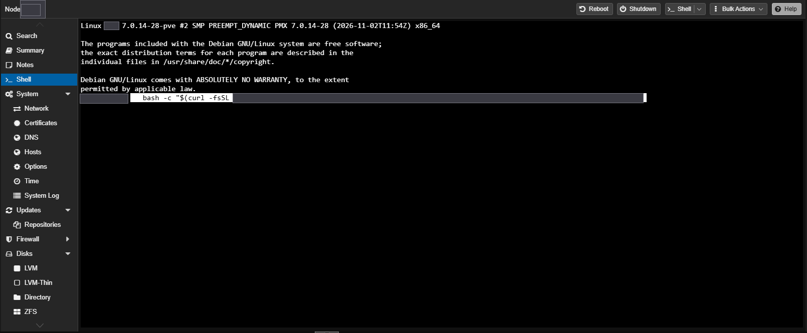

### 2. Saisir les identifiants API

Collez le **Client ID**, validez avec Entrée, puis le **Client Secret**. Le secret ne s'affiche pas pendant la saisie, c'est normal.

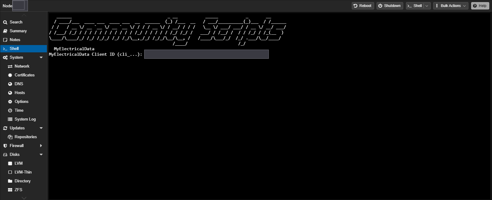

### 3. Choisir la bêta

À la question « Version à installer », tapez **2** puis Entrée. Entrée seule installe la version stable.

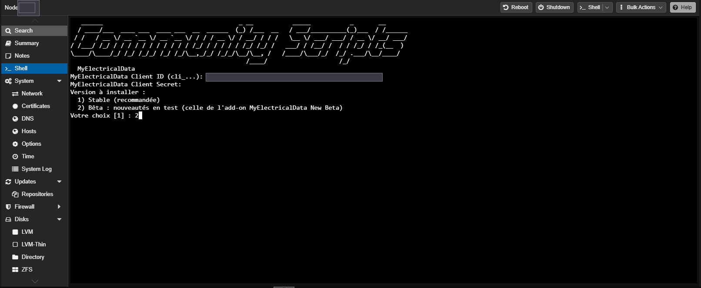

> [!TIP]
> Sans question : ajoutez `var_med_beta="yes"` (ou `"no"`) devant la commande.

### 4. Choisir le type d'installation

**Default Install** convient dans la plupart des cas. **Advanced Install** permet de choisir le numéro du conteneur, son nom, le stockage ou l'adresse IP.

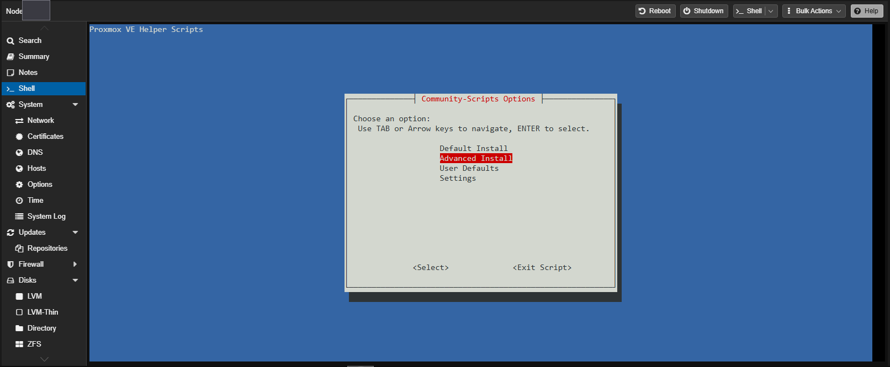

### 5. Avec Advanced Install : numéro et nom

Gardez le numéro proposé (le premier libre) ou choisissez-en un. Donnez un nom clair, par exemple `myelectricaldata-beta`. Les autres écrans peuvent rester sur leurs valeurs par défaut.

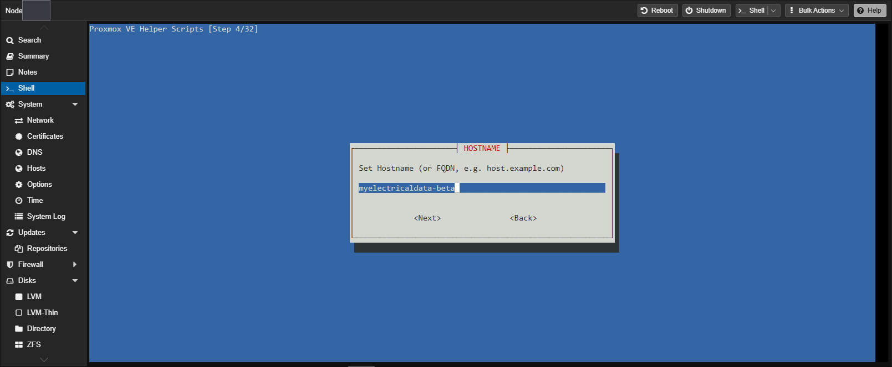

### 6. Confirmer

Le récapitulatif résume les réglages. Choisissez **Yes**, puis le stockage du conteneur (en général `local-lvm`, coché avec Espace puis Ok).

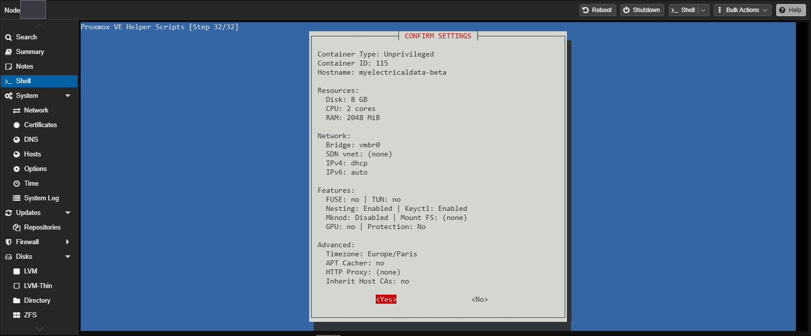

### 7. Laisser l'installation se faire

La ligne **Fetched MyElectricalData … (beta …, … patches)** confirme que la bêta est installée. L'adresse de l'interface (port `8100`) s'affiche à la fin.

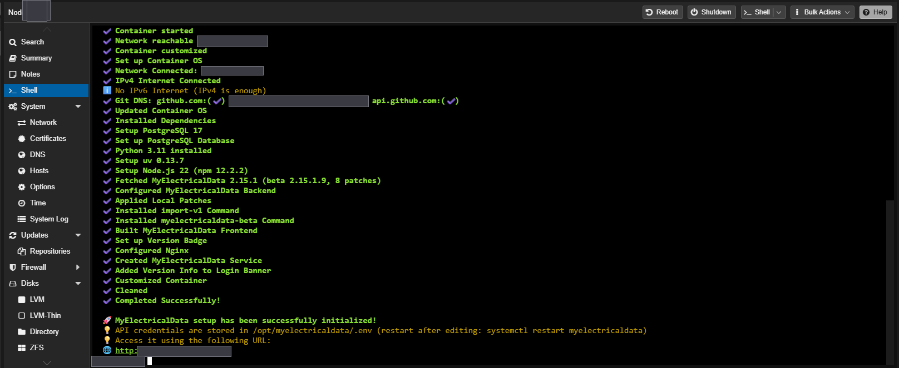

## Conteneur déjà installé : passer en bêta sans réinstaller

L'historique, les identifiants API (`.env`), l'offre choisie et les réglages sont conservés. Seul le programme MyElectricalData est remplacé.

### 1. Sauvegarder le conteneur

Dans Proxmox : **votre conteneur › Backup › Backup now**, puis attendez « TASK OK ».

### 2. Récupérer la commande

À taper dans la **console du conteneur**. Une seule fois, pour un conteneur installé avant le 10/11/2026 ; les conteneurs plus récents l'ont déjà.

```bash
curl -fsSL https://raw.githubusercontent.com/Marlboro62/myelectricaldata-proxmox/main/tools/myelectricaldata-beta -o /usr/local/bin/myelectricaldata-beta
chmod +x /usr/local/bin/myelectricaldata-beta
```

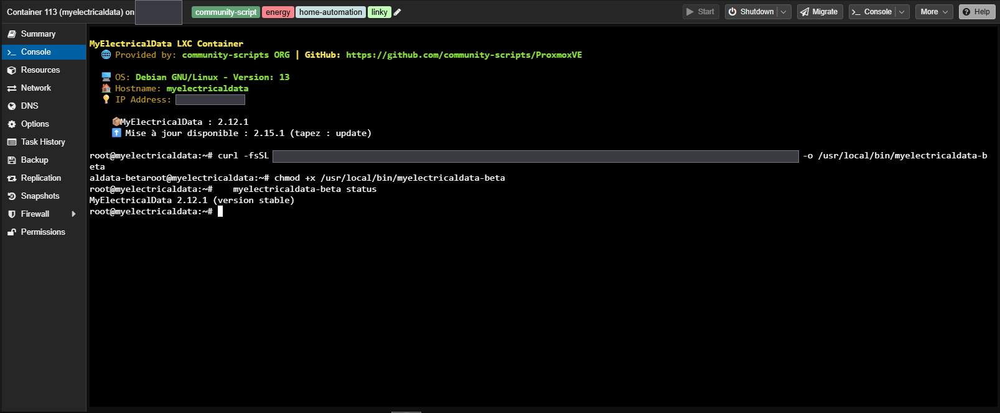

### 3. Passer en bêta

Dans la **console du conteneur** :

```bash
myelectricaldata-beta on
```

La commande sauvegarde la base dans `/root/backup-avant-beta-<date>.sql`, prépare la bêta à côté de l'installation actuelle, puis la remplace. Si une étape échoue, l'installation précédente est gardée ou remise en place.

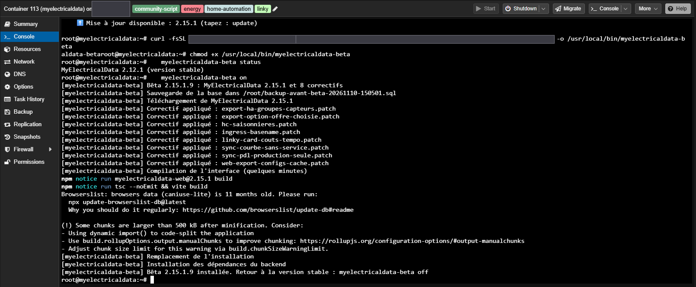

> [!NOTE]
> La commande refuse le passage si la version stable installée est plus récente que celle de la bêta : la base ne peut pas revenir en arrière. Il suffit alors d'attendre la bêta suivante.

## Vérifier que la bêta est installée

### Dans la console du conteneur

```bash
myelectricaldata-beta status
```

Réponse attendue : `MyElectricalData 2.15.1, bêta 2.15.1.x`.

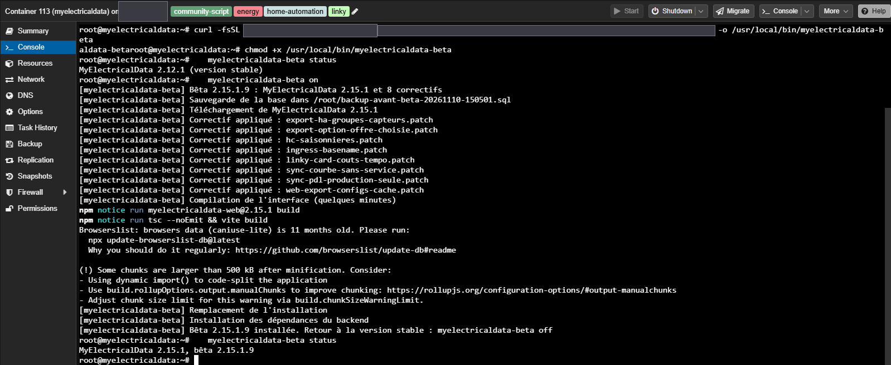

Sur un conteneur installé avec le choix bêta, l'accueil de la console l'indique aussi :

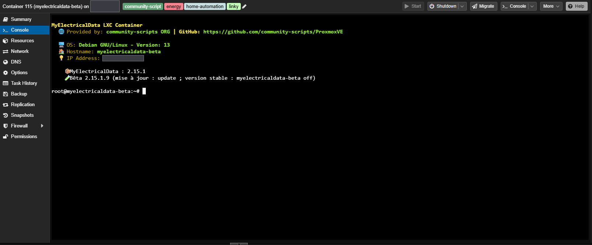

### Dans l'interface

Rechargez la page avec **Ctrl+F5**. En bas à gauche, sous « Préférences », la version est suivie de **BÊTA** (point vert : dernière bêta installée).

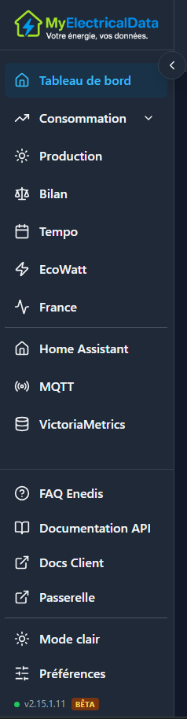

## Heures creuses saisonnières

Avec la réforme des heures creuses, les plages peuvent changer entre l'hiver et l'été. Votre fournisseur vous indique les vôtres.

| Saison | Période |
| --- | --- |
| Hiver | du 1er novembre au 31 mars |
| Été | du 1er avril au 31 octobre |

### 1. Ouvrir le bloc

Tableau de bord › carte du point de livraison › sous **Heures creuses**, cochez **Heures creuses saisonnières**.

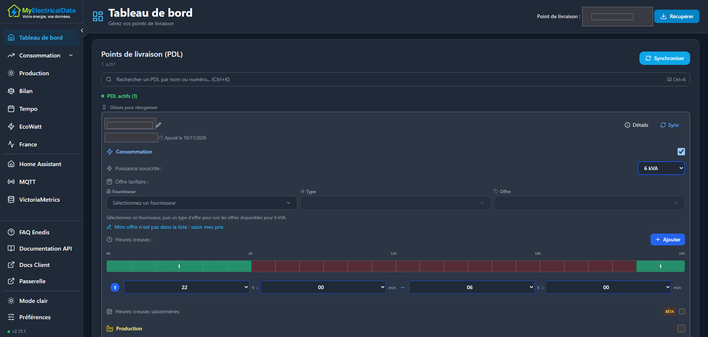

### 2. Saisir la date et les plages

Indiquez la date du changement (**À partir du**), puis les plages de chaque saison. Le bouton **+** de la ligne d'une saison ajoute une plage à cette saison. Le total s'affiche à droite : 8 h par jour avec la réforme.

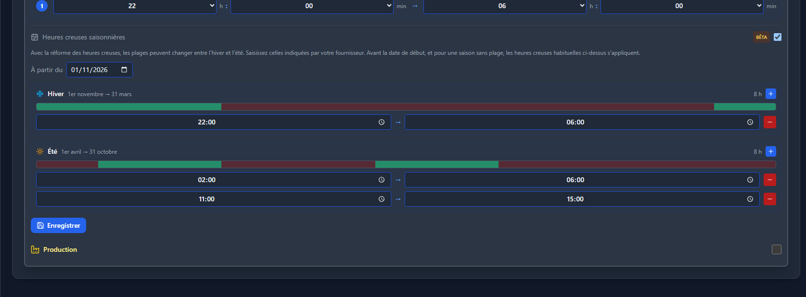

### 3. Enregistrer

Cliquez sur **Enregistrer** : la notification « Heures creuses saisonnières enregistrées » confirme.

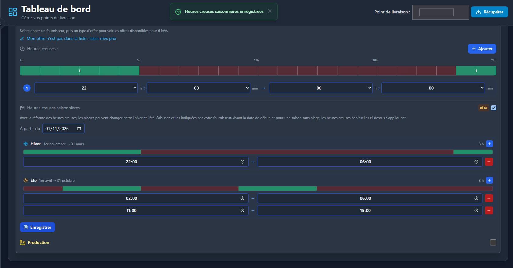

### Quelles plages s'appliquent ?

| Situation | Plages utilisées |
| --- | --- |
| Avant la date de début | Heures creuses habituelles : l'historique n'est pas recalculé |
| Saison sans plage saisie | Heures creuses habituelles |
| Offre Tempo | 22h → 6h toute l'année : Tempo n'est pas concerné par la réforme |
| Synchronisation | Les plages saisonnières sont conservées |

Les pages **Consommation** (kWh et €) et l'export Home Assistant (HC, HP et coûts de la carte Linky) suivent la saison du jour.

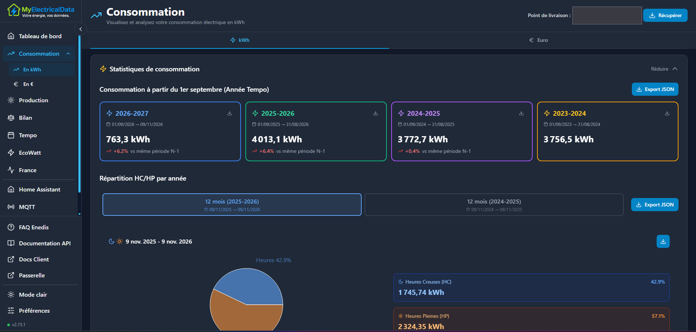

## Mises à jour et retour à la version stable

Commandes à taper dans la **console du conteneur** :

| Commande | Effet |
| --- | --- |
| `update` | Met à jour la bêta (le conteneur suit la bêta tant qu'il y est) |
| `myelectricaldata-beta status` | Affiche la version installée |
| `myelectricaldata-beta off` | Revient à la dernière version stable, avec une sauvegarde de la base |
| `myelectricaldata-beta on` | Passe en bêta, ou installe la dernière bêta |

Chaque passage garde une sauvegarde de la base dans `/root/backup-avant-…sql` (une dizaine de Mo). Supprimez les anciennes quand la bêta vous convient.

---

Retours et problèmes : [issues GitHub](https://github.com/Marlboro62/myelectricaldata-proxmox/issues). Les captures ont été masquées (identifiants, adresses, point de livraison).
